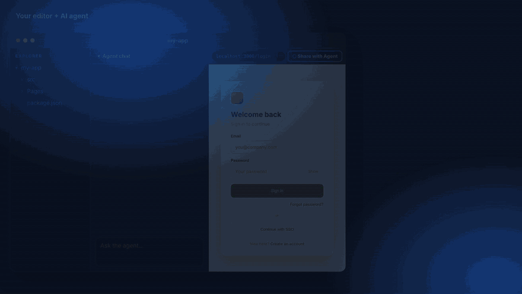
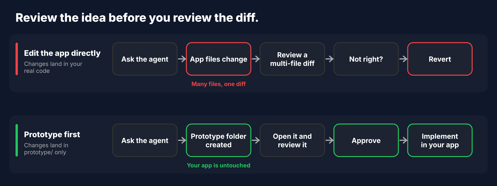
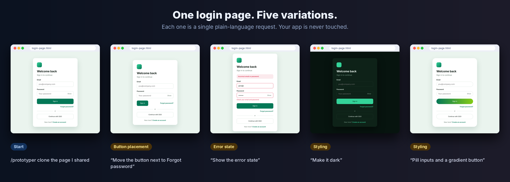
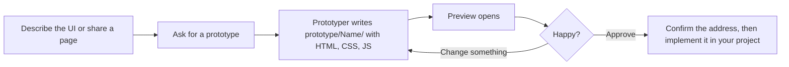
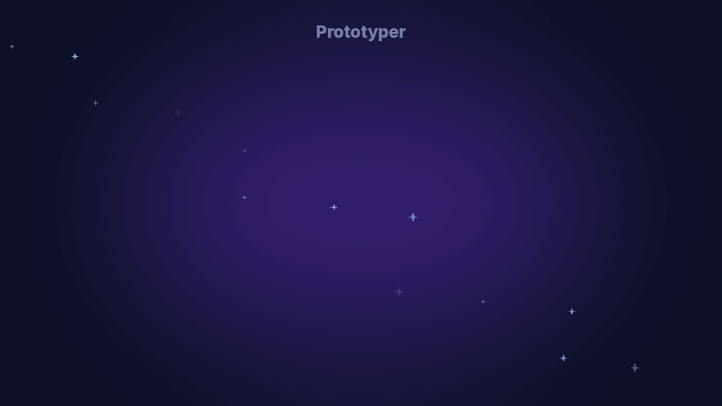

<div align="center">

# Prototyper

**An agent skill that turns a plain-language request, or a page you share, into a working UI prototype in its own folder, so your app stays untouched.**

[](https://skills.sh/CrystaCode/crystacode-toolbox/prototyper)
[](LICENSE)

[The problem](#a-tiny-ui-question-should-not-cost-a-whole-app) · [The fix](#a-prototype-lane-next-to-your-app) · [Get started](#get-started-in-four-steps)

</div>

<details open>
<summary><h2>A tiny UI question should not cost a whole app</h2></summary>

Take the simplest page you own: a **login page**. You want to see it a few different ways. The button in another spot. An inline error instead of a pop-up. A darker style. Four or five variations, side by side.

That is a ten-minute question. In a real app, it rarely is.

### What it actually takes

- **Full-stack overhead.** To look at one error state you open the component, its styles, the form logic and the routing. You wire up fake auth responses, mock routes or seed data, just to make the page fail on purpose. A missing dependency or a framework quirk can turn a color check into an afternoon.
- **Tokens burned on trivial tweaks.** Ask an AI agent to move a button and it reads, searches and edits across your whole stack. You pay for a lot of context that has nothing to do with the question, and then you ask for variation number two.
- **Slow loops.** Every variation waits on a rebuild or a reload, and then you walk the flow again: open the page, sign in wrong on purpose, look, go back. Repeat for every idea.
- **A diff to review and a mess to undo.** Variation three was the winner, so now you revert the other two.

### You have felt this

If you have ever opened a project to nudge one button and closed it an hour later with a half-built mock API, you know exactly what this is. You were not trying to build a feature. You were trying to **look at** one.

The slow part was never the design. It was everything around it.

</details>

<details open>
<summary><h2>A prototype lane next to your app</h2></summary>

**Prototyper** is a lightweight prototyping skill for your AI coding agent. Describe a UI, or share a page you already have, and it builds the UI as three small, standalone files (HTML, CSS and JavaScript) in their own folder, outside your app. Open the file in a browser, ask for changes in plain language, and compare variations without a build, a route or a mock in sight.



*Click Share with Agent in the editor's browser, run `/prototyper`, and the agent clones the page you shared. Changes go to the prototype only; your app stays untouched. An illustration built from a real login prototype, not a screen recording.*

### The difference

| | Changing the real app | With Prototyper |
| --- | --- | --- |
| What the agent touches | Components, styles, state, routes, mock data | One folder with three small files |
| Token use | High: it reads and edits across the stack for every tweak | Much lower: it reads and rewrites three small files |
| Iteration speed | Rebuild or reload the app, then re-walk the flow | Near-instant: reload one HTML file |
| Risk | Changes land in your codebase and may need reverting | Nothing in your app changes until you ask |

> *A relative comparison of what the agent has to read, edit and wait for, not a benchmark. Actual savings depend on your project and agent.*



### The login page, again

Every variation below is one plain-language request, and every one lives in the same three files.



### Two ways to start

**Prompt Mode: say what you want.** There is no page to copy: a new component, a screen that does not exist yet, a quick concept for your team. You do not need to share a page or a URL.

**Clone Mode: start from a page you already have.** Share a page open in your agent's browser, or give a URL and the agent opens it with a browser tool such as the Playwright MCP server. Prototyper reads the live page (DOM, styles, SVGs, assets), not a screenshot, builds a replica, and compares element positions, sizes and colors with your page.

| | Prompt Mode | Clone Mode |
| --- | --- | --- |
| Starting point | A text description | A shared page or URL |
| Shared browser page or URL needed | No | Yes |
| Fidelity goal | Match your description | Match the original page |
| Self-check against a page | No | Yes |
| Best for | New components, concepts, early ideas | Redesign or rebuild what exists |
| Output | `prototype/{name}/` (HTML, CSS, JS) | `prototype/{name}/` (HTML, CSS, JS) |

> *Prompt Mode has no page to compare against, so the result reflects your description. Be specific about content, states and interactions.*

### When you are happy

Ask Prototyper to implement it. It **confirms the address with you first** (folder, name, route), then builds it in your project's own structure, for example a Blazor `.razor` component with scoped CSS. See [Implementing the prototype in your app](#implementing-the-prototype-in-your-app).

- **Use it when** you want to explore, redesign or rebuild a page, build a new component from a description, or show a change before building it.
- **Skip it when** the change is a one-line style tweak or has no UI.

Prototyper is an agent skill, so it works in any AI agent that supports skills.

</details>

<details open>
<summary><h2>Get started in four steps</h2></summary>

### 1. Install

```bash
npx skills add CrystaCode/crystacode-toolbox --skill prototyper
```

Choose the agent or agents to install it on when prompted. Then open your agent chat and type `/prototyper`. The skill should appear in the list.

### 2. Run it

Type `/prototyper` followed by what you want, in plain language:

```markdown
/prototyper a login page with email, password and a Sign in button
```

A prototype appears in `prototype/login-page/`. Open `login-page.html` in a browser.

### 3. Change it

Reply in plain language. No commands to learn:

```text
Move the button next to "Forgot password".
Show the error state.
Make it dark.
```

### 4. Implement it when you are ready

```text
Looks great. Implement it in our project.
```

Prototyper asks where it should live, waits for your yes, and builds it in your stack.

### More ways to run it

```markdown
/prototyper create a prototype for the page I have shared in the browser.
/prototyper create a prototype for https://example.com/admin/agents
/prototyper I want a settings page. Use our design system: Inter font, 8px spacing, brand color #0a66c2.
```

**Finalize:** *"Looks good. Please finalize it."* The cleaned files land in `final/<name>/`.

### Requirements

- An AI agent that supports skills.
- **Prompt Mode:** nothing else.
- **Clone Mode:** a browser tool the agent can use to open and inspect the page: an integrated browser with page sharing, or a Playwright MCP server for opening a URL.

<details>
<summary>Other install options</summary>

**Claude Code plugin:**

```bash
claude plugin marketplace add CrystaCode/crystacode-toolbox
claude plugin install prototyper@crystacode-toolbox
```

Plugin skills are namespaced by the plugin name. If `/prototyper` is not listed, type `/prototyper:prototyper`.

**Manual** (any agent that reads `.agents/skills/`):

```bash
mkdir -p .agents/skills
cp -r skills/prototyper .agents/skills/
```

</details>

</details>

<details open>
<summary><h2>Implementing the prototype in your app</h2></summary>

Your app is not touched while you iterate. When you are happy, ask Prototyper to implement the prototype:

```markdown
Looks great. Implement it in our project.
```

Prototyper then works in four steps:

1. **It confirms the address with you.** Before it writes anything in your project, it proposes where the result should live (folder, component name, route, navigation) and waits for your yes. For example: *"I would create `Components/Pages/AgentsDashboard.razor` with scoped CSS, routed at `/agents`. Is that right?"*
2. **It learns your project's structure.** It detects your stack and reads one or two similar components to follow your naming, folder layout, styling and routing conventions.
3. **It builds the result in your project's own structure.** The prototype's plain HTML, CSS and JS become idiomatic code for your stack, styled with your design system, not three loose files dropped into the project.
4. **It verifies and reports.** It runs your build and checks, compares the result with the approved prototype, and lists every file it created or changed.

| Your project | Prototyper builds |
| --- | --- |
| **Blazor** | A `.razor` component (`@page` for pages) with scoped `Name.razor.css`, interaction in C# state and event handlers |
| **Razor Pages or MVC** | A `.cshtml` page or partial with the project's styles and scripts |
| **React or Next.js** | A component in your language, styled the way your project styles |
| **Vue or Nuxt** | A single-file component |
| **Angular** | A component with `.ts`, `.html` and `.scss` |
| **Plain HTML** | The final files, copied to the folder you choose |

Tips for a good result:

- **Approve first.** Make every change you want while the prototype is still three small files, then ask for implementation.
- **Answer the address question precisely.** Say the folder, the name and the route you want, or correct its proposal.
- **Name your conventions.** Mention your component library or design system, or point to one existing component to follow.
- **Provide the real data source.** Sample data stays as marked placeholder data until you say which API or service to use.
- **Work on a branch.** It keeps the change easy to review or discard.

</details>

<details>
<summary><h2>Reference: how it works, a real run, implementing, FAQ</h2></summary>

## How it works



1. **Start.** Describe the UI you want, or share a page you already have open.
2. **Ask for a prototype.** Type `/prototyper` followed by what you want, in plain language.
3. **Prototyper builds it.** Three plain files appear in a new, meaningfully named folder under `prototype/`.
4. **Review and iterate.** Preview it, ask for changes in plain language, repeat.
5. **Implement it.** When you approve, ask Prototyper to implement it in your project. It confirms where it should go, then builds it in your stack (for example a Blazor component). See [Implementing the prototype](#implementing-the-prototype-in-your-app).

## Clone Mode in a real run

**Use it when** you want to redesign, rebuild or experiment on an existing screen and need a faithful starting point.
Share a page you have open in your agent's integrated browser, or give a URL and the agent opens it with a browser tool such as the Playwright MCP server.

```markdown
/prototyper create a prototype for the page I have shared in the browser.
```

1. Prototyper reads the live page: DOM, styles, SVGs and asset URLs. It does not work from a screenshot.
2. It writes `prototype/agent-management-dashboard/` and opens it next to your page.
3. It compares element positions, sizes and colors against your page and fixes differences.
4. You review, ask for changes, then approve.

**You get** a standalone replica that looks like your page and behaves like it for the interactions you can see.
**Keep in mind:** it replicates what is rendered when you share it. Other states need to be opened or requested,
and the mode needs a browser tool, such as an integrated browser or a Playwright MCP server.



*A real Clone Mode run. The chat and code panels are redrawn from the real text for clarity, and private details are removed.*

## What you get

```text
prototype/<name>/     # the prototype you review and iterate on
├── <name>.html
├── <name>.css
└── <name>.js

final/<name>/         # only after you approve: cleaned and accessible
└── (same three files)
```

`prototype/` is a sandbox. `final/` is the same UI with production CSS, modular JavaScript and
accessibility improvements. Both are standalone: open the `.html` file in a browser.

When you ask Prototyper to implement it, the component lands in your project at the address you confirmed, in your stack's structure. See [Implementing the prototype](#implementing-the-prototype-in-your-app).

## Best practices

- **Be specific.** Describe content, states and interactions, and list the features you want.
- **Share the right tab.** In Clone Mode, share the page logged in and showing the state you want to clone.
- **One component or page per run.** Large pages work better as several prototypes.
- **Review before iterating.** Open the preview, list every change you want, then ask once.
- **Treat the prototype as the spec.** Implement it only after sign-off, and confirm the address when Prototyper asks.
- **Keep prototypes out of production bundles** by leaving `prototype/` unreferenced.

## Limitations

- Clone Mode replicates what is rendered when you share it. Other states (hover, modal, empty) need to be opened or requested.
- Pages behind a login need to be open in your session and shared.
- Images and fonts may still load from the original page's URLs, so a clone can depend on the original site being reachable.
- The comparison checks element position, size, color, display and position. Fonts, shadows and animation are reviewed by eye.
- By default, output uses the CrystaCode design tokens. Ask for your own design system to replace them.
- Each run starts fresh and does not reuse earlier prototypes, by design.
- Implementation follows what your project already uses. Prototyper does not add new frameworks or libraries, and it connects real data only when you name the source.

## FAQ

**Does it change my application?** Not until you ask. It writes into `prototype/` and, if you ask, `final/`. When you ask it to implement the prototype, it confirms the address with you first and then adds or changes only the files that component needs.

**Is this a screenshot-to-code tool?** No. In Clone Mode it reads the live page's DOM and computed styles.

**Which agents does it work with?** Any agent that supports skills. Clone Mode also needs a browser tool: an integrated browser or a Playwright MCP server.

**Do I need to share a page or a URL?** Not in Prompt Mode, which works from a description alone. In Clone Mode, either share a page you have open or give a URL. The agent opens the URL with a browser tool such as the Playwright MCP server and clones it.

**Can I use my own design system?** Yes. The CrystaCode tokens are a default; tell Prototyper to use yours.

**Why generate a prototype first?** It lets you and your team review the result instead of the diff, and costs nothing to throw away.

</details>

## Contributing

Issues and pull requests are welcome. See [CONTRIBUTING.md](../../CONTRIBUTING.md). Release notes are in [CHANGELOG.md](../../CHANGELOG.md).

## License

[MIT](LICENSE) © CrystaCode
