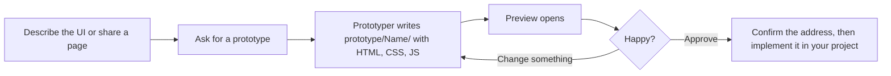
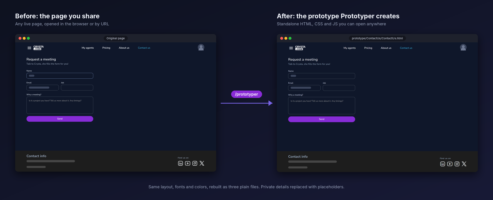
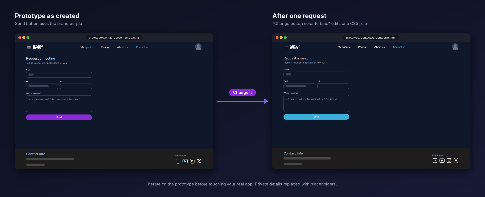

<div align="center">

# Prototyper

**Prototype before you implement.**

Describe a UI, or share a page you already have, and get a light, standalone HTML, CSS and JS
prototype to review and change freely. Implement it in your app only when you are happy with it.

[](https://skills.sh/CrystaCode/crystacode-toolbox/prototyper)
[](LICENSE)

[Install](#installation) · [How it works](#how-it-works) · [Two ways to start](#two-ways-to-start) · [Usage](#usage)


</div>

---

## Quick start

```bash
npx skills add CrystaCode/crystacode-toolbox --skill prototyper
```

Then, in your agent chat:

```markdown
/prototyper I want a dark-themed pricing card with a monthly/yearly toggle.
```

A standalone prototype appears in `prototype/pricing-card/`. Open it, ask for changes, and implement it in your app only when you are happy.

## Why Prototyper

When an AI agent edits your real codebase to try a UI idea, you get a multi-file diff to review,
a change to undo if you do not like it, and nothing to show your team until the work is done.

**Prototyper adds a safe step in between.** It writes a standalone prototype into its own folder:

```text
prototype/agent-dashboard/
├── agent-dashboard.html
├── agent-dashboard.css
└── agent-dashboard.js
```

Open it, click through it, ask for changes, and show it to your team. Nothing in your app has changed.
When you approve it, ask Prototyper to implement it in your project. It confirms the address with you first and builds it in your project's own structure.

|  | Edit the app directly | Prototype first |
| --- | --- | --- |
| Where changes land | In your app files | In `prototype/` only |
| How you review | Read a diff | Open one page |
| Reject an idea | Revert changes | Delete a folder |
| Fidelity to an existing page | Rebuilt from source | Read from the live page and compared |


**Use it when** you want to explore, redesign or rebuild a page, build a new component from a description,
or show a change before building it.
**Skip it when** the change is a one-line style tweak or has no UI.

Prototyper is an agent skill, so it works in any AI agent that supports skills.

## How it works



1. **Start.** Describe the UI you want, or share a page you already have open.
2. **Ask for a prototype.** Type `/prototyper` followed by what you want, in plain language.
3. **Prototyper builds it.** Three plain files appear in a new, meaningfully named folder under `prototype/`.
4. **Review and iterate.** Preview it, ask for changes in plain language, repeat.
5. **Implement it.** When you approve, ask Prototyper to implement it in your project. It confirms where it should go, then builds it in your stack (for example a Blazor component). See [Implementing the prototype](#implementing-the-prototype-in-your-app).

## Two ways to start

Prototyper picks its mode from what you give it: a shared page or URL means **Clone**;
a description with no page means **Prompt**.

### Prompt Mode: say what you want

**Use it when** there is no page to copy: a new component, a screen that does not exist yet,
or a quick concept to show your team. You do not need to share a browser page or a URL.

```markdown
/prototyper I want a dark-themed pricing card with a monthly/yearly toggle.
```

1. Prototyper reads your description and designs a complete, responsive layout with interactions.
2. It writes `prototype/pricing-card/` and opens the preview.
3. You review, ask for changes, then approve.

**You get** a standalone, interactive prototype in its own folder.
**Keep in mind:** there is no page to compare against, so the result reflects your description.
Be specific about content, states and interactions.

### Clone Mode: replicate a page you already have

**Use it when** you want to redesign, rebuild or experiment on an existing screen and need a faithful starting point.
Share a page you have open in your agent's integrated browser, or give a URL and the agent opens it with a browser tool such as the Playwright MCP server.

```markdown
/prototyper create a prototype for the page I have shared in the browser.
```

1. Prototyper reads the live page: DOM, styles, SVGs and asset URLs. It does not work from a screenshot.
2. It writes `prototype/agent-management-dashboard/` and opens it next to your page.
3. It compares element positions, sizes and colors against your page and fixes differences.
4. You review, ask for changes, then approve.

See [a real run](#see-it-in-action) below.

**You get** a standalone replica that looks like your page and behaves like it for the interactions you can see.
**Keep in mind:** it replicates what is rendered when you share it. Other states need to be opened or requested,
and the mode needs a browser tool, such as an integrated browser or a Playwright MCP server.

| | Prompt Mode | Clone Mode |
| --- | --- | --- |
| Starting point | A text description | A shared page or URL |
| Shared browser page or URL needed | No | Yes |
| Fidelity goal | Match your description | Match the original page |
| Self-check against a page | No | Yes |
| Best for | New components, concepts, early ideas | Redesign or rebuild what exists |
| Output | `prototype/{name}/` (HTML, CSS, JS) | `prototype/{name}/` (HTML, CSS, JS) |

Both modes share the same loop: preview, iterate, approve, and optionally finalize into `final/{name}/`.

## See it in action

**Watch a real run (Clone Mode).** From sharing a page to a checked prototype and a one-sentence change.


**The result.** The left side is the page shared with the agent. The right side is the prototype Prototyper created.



**Ask for a change.** One plain-language request updates only the files that need to change.



*The images come from a real run. Private details are replaced with placeholders, and the chat and code panels in the video are redrawn from the real text for clarity.*

## Key features

| Feature | What it does for you |
| --- | --- |
| **Prompt Mode** | Builds a complete interactive UI from a description. No shared page or URL needed |
| **Clone Mode** | Rebuilds a shared page or URL from its real DOM, styles and assets, not from a screenshot |
| **Self-checking** | In Clone Mode, compares element positions, sizes and colors with your page and fixes mismatches before showing you |
| **Isolated output** | Every prototype gets its own folder under `prototype/`. Your app files are never touched |
| **Iterate by conversation** | Ask for changes in plain language. Only the files that need to change are updated |
| **Finalize on request** | Produces a cleaned, accessible version in `final/` |
| **Implement in your stack** | After you approve, confirms the address with you and builds the prototype as a real component in your project, such as a Blazor `.razor` component |
| **No framework lock-in** | Plain HTML5, CSS3 and ES6 JavaScript. No build tools |
| **Your design system** | Uses the CrystaCode design tokens by default. Ask it to use your own instead |

## Installation

```bash
npx skills add CrystaCode/crystacode-toolbox --skill prototyper
```

`prototyper` is one skill in the CrystaCode toolbox, so `--skill prototyper` installs just this one. Choose the agent or agents to install it on when prompted.

**Check it worked:** open your agent chat and type `/prototyper`. The skill should appear in the list.

<details>
<summary>Other install options</summary>

**Claude Code plugin:**

```bash
claude plugin marketplace add CrystaCode/crystacode-toolbox
claude plugin install prototyper@crystacode-toolbox
```

Plugin skills are namespaced by the plugin name. If `/prototyper` is not listed, type `/prototyper:prototyper`.

**Manual** (any agent that reads `.agents/skills/`):

```bash
mkdir -p .agents/skills
cp -r skills/prototyper .agents/skills/
```

</details>

### Requirements

- An AI agent that supports skills.
- **Prompt Mode:** nothing else.
- **Clone Mode:** a browser tool the agent can use to open and inspect the page: an integrated browser with page sharing, or a Playwright MCP server for opening a URL.

## Usage

Type `/prototyper` followed by what you want, in plain language.

**Describe a UI:**

```markdown
/prototyper I want a dark-themed pricing card with a monthly/yearly toggle.
```

**Clone the page you have open:**

```markdown
/prototyper create a prototype for the page I have shared in the browser.
```

**Clone a URL:**

```markdown
/prototyper create a prototype for https://example.com/admin/agents
```

**Iterate:** reply in plain language, for example *"Make the 'Most Popular' card glow."*

**Finalize:** *"Looks good. Please finalize it."* The cleaned files land in `final/<name>/`.

**Implement in your project:** *"Looks good. Implement it in our project."* Prototyper confirms the address with you, then builds it in your project's structure.

**Use your own design system:** add it to the request, for example *"Use our design system: Inter font, our color palette, 8px spacing."*

## What you get

```text
prototype/<name>/     # the prototype you review and iterate on
├── <name>.html
├── <name>.css
└── <name>.js

final/<name>/         # only after you approve: cleaned and accessible
└── (same three files)
```

`prototype/` is a sandbox. `final/` is the same UI with production CSS, modular JavaScript and
accessibility improvements. Both are standalone: open the `.html` file in a browser.

When you ask Prototyper to implement it, the component lands in your project at the address you confirmed, in your stack's structure. See [Implementing the prototype](#implementing-the-prototype-in-your-app).

## Implementing the prototype in your app

Your app is not touched while you iterate. When you are happy, ask Prototyper to implement the prototype:

```markdown
Looks great. Implement it in our project.
```

Prototyper then works in four steps:

1. **It confirms the address with you.** Before it writes anything in your project, it proposes where the result should live (folder, component name, route, navigation) and waits for your yes. For example: *"I would create `Components/Pages/AgentsDashboard.razor` with scoped CSS, routed at `/agents`. Is that right?"*
2. **It learns your project's structure.** It detects your stack and reads one or two similar components to follow your naming, folder layout, styling and routing conventions.
3. **It builds the result in your project's own structure.** The prototype's plain HTML, CSS and JS become idiomatic code for your stack, styled with your design system, not three loose files dropped into the project.
4. **It verifies and reports.** It runs your build and checks, compares the result with the approved prototype, and lists every file it created or changed.

| Your project | Prototyper builds |
| --- | --- |
| **Blazor** | A `.razor` component (`@page` for pages) with scoped `Name.razor.css`, interaction in C# state and event handlers |
| **Razor Pages or MVC** | A `.cshtml` page or partial with the project's styles and scripts |
| **React or Next.js** | A component in your language, styled the way your project styles |
| **Vue or Nuxt** | A single-file component |
| **Angular** | A component with `.ts`, `.html` and `.scss` |
| **Plain HTML** | The final files, copied to the folder you choose |

Tips for a good result:

- **Approve first.** Make every change you want while the prototype is still three small files, then ask for implementation.
- **Answer the address question precisely.** Say the folder, the name and the route you want, or correct its proposal.
- **Name your conventions.** Mention your component library or design system, or point to one existing component to follow.
- **Provide the real data source.** Sample data stays as marked placeholder data until you say which API or service to use.
- **Work on a branch.** It keeps the change easy to review or discard.

## Best practices

- **Be specific.** Describe content, states and interactions, and list the features you want.
- **Share the right tab.** In Clone Mode, share the page logged in and showing the state you want to clone.
- **One component or page per run.** Large pages work better as several prototypes.
- **Review before iterating.** Open the preview, list every change you want, then ask once.
- **Treat the prototype as the spec.** Implement it only after sign-off, and confirm the address when Prototyper asks.
- **Keep prototypes out of production bundles** by leaving `prototype/` unreferenced.

## Limitations

- Clone Mode replicates what is rendered when you share it. Other states (hover, modal, empty) need to be opened or requested.
- Pages behind a login need to be open in your session and shared.
- Images and fonts may still load from the original page's URLs, so a clone can depend on the original site being reachable.
- The comparison checks element position, size, color, display and position. Fonts, shadows and animation are reviewed by eye.
- By default, output uses the CrystaCode design tokens. Ask for your own design system to replace them.
- Each run starts fresh and does not reuse earlier prototypes, by design.
- Implementation follows what your project already uses. Prototyper does not add new frameworks or libraries, and it connects real data only when you name the source.

## FAQ

**Does it change my application?** Not until you ask. It writes into `prototype/` and, if you ask, `final/`. When you ask it to implement the prototype, it confirms the address with you first and then adds or changes only the files that component needs.

**Is this a screenshot-to-code tool?** No. In Clone Mode it reads the live page's DOM and computed styles.

**Which agents does it work with?** Any agent that supports skills. Clone Mode also needs a browser tool: an integrated browser or a Playwright MCP server.

**Do I need to share a page or a URL?** Not in Prompt Mode, which works from a description alone. In Clone Mode, either share a page you have open or give a URL. The agent opens the URL with a browser tool such as the Playwright MCP server and clones it.

**Can I use my own design system?** Yes. The CrystaCode tokens are a default; tell Prototyper to use yours.

**Why generate a prototype first?** It lets you and your team review the result instead of the diff, and costs nothing to throw away.

## Contributing

Issues and pull requests are welcome. See [CONTRIBUTING.md](../../CONTRIBUTING.md). Release notes are in [CHANGELOG.md](../../CHANGELOG.md).

## License

[MIT](LICENSE) © CrystaCode
